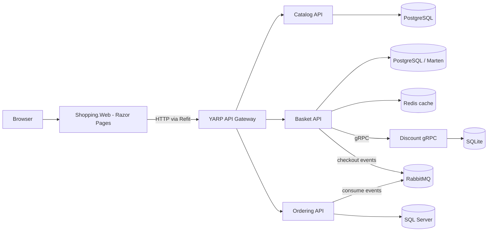

# EShop Microservices

An e-commerce microservices application built with .NET 10. The solution includes a Razor Pages storefront, a YARP API gateway, and Catalog, Basket, Discount, and Ordering services.

**Course:** [Step by Step Development of this Repository](https://www.udemy.com/course/microservices-architecture-and-implementation-on-dotnet/?couponCode=MARC24)


## Architecture



### Components

| Component | Responsibility | Main technology / data store |
| --- | --- | --- |
| `Shopping.Web` | Storefront and Razor Pages; calls backend APIs through Refit | ASP.NET Core Razor Pages |
| `YarpApiGateway` | Routes HTTP API requests to Catalog, Basket, and Ordering | YARP reverse proxy |
| `Catalog.API` | Product listing, lookup, category filtering, and product management | Carter, MediatR, Marten, PostgreSQL |
| `Basket.API` | Shopping cart operations and checkout; uses Discount and publishes messages | Carter, MediatR, Marten, PostgreSQL, Redis, gRPC, MassTransit |
| `Discount.Grpc` | Discount lookup service used by Basket | gRPC, Entity Framework Core, SQLite |
| `Ordering.API` | Order creation, lookup, update, and deletion | Carter, CQRS layers, Entity Framework Core, SQL Server, MassTransit |
| `BuildingBlocks` | Shared CQRS interfaces, behaviors, validation, exceptions, and pagination | MediatR, FluentValidation, Mapster |
| `BuildingBlocks.Messaging` | Shared RabbitMQ/MassTransit integration | MassTransit |

The solution is in [`src/eshop-microservices.sln`](src/eshop-microservices.sln). Ordering is split into API, Application, Domain, and Infrastructure projects.

## Run with Docker Compose

### Prerequisites

- Docker Desktop with Docker Compose
- .NET 8 SDK, if building or running projects outside containers

The Compose files are in `src`. From the repository root, start the full stack with:

```powershell
cd src
docker compose up --build
```

Compose builds and starts the web app, gateway, APIs, and their data/message infrastructure. Open the storefront at:

| Application | HTTP | HTTPS |
| --- | --- | --- |
| Shopping.Web | <http://localhost:6005> | <https://localhost:6065> |
| YARP API Gateway | <http://localhost:6004> | <https://localhost:6064> |

The web app's Razor Page routes include `/`, `/ProductList`, `/Cart`, `/Checkout`, and `/OrderList`. These are storefront pages, not YARP API routes.

To stop the stack, run `docker compose down` from `src`. PostgreSQL data is stored in named Compose volumes and remains after stopping the stack. `docker compose down -v` also removes those volumes and their data.

The Compose override contains development credentials and local settings. Do not reuse those credentials outside a local development environment.

## Local ports

The published ports are configured in [`src/docker-compose.override.yml`](src/docker-compose.override.yml):

| Service | HTTP | HTTPS |
| --- | ---: | ---: |
| Catalog API | 6000 | 6060 |
| Basket API | 6001 | 6061 |
| Discount gRPC | 6002 | 6062 |
| Ordering API | 6003 | 6063 |
| YARP API Gateway | 6004 | 6064 |
| Shopping.Web | 6005 | 6065 |

Infrastructure ports include PostgreSQL (`5432`, `5433`), Redis (`6379`), SQL Server (`1433`), and RabbitMQ (`5672`; management UI `15672`). Between containers, services use Compose service names such as `catalog.api` and `yarpapigateway`, rather than `localhost`.

## API routing

YARP route prefixes are configured in [`src/ApiGateways/YarpApiGateway/appsettings.json`](src/ApiGateways/YarpApiGateway/appsettings.json). The gateway strips each public service prefix before forwarding the remaining path to the API:

| Public gateway path | Forwarded API path | Service |
| --- | --- | --- |
| `/catalog-service/products` | `/products` | Catalog |
| `/basket-service/basket/{userName}` | `/basket/{userName}` | Basket |
| `/ordering-service/orders` | `/orders` | Ordering |

For example, `http://localhost:6004/catalog-service/products` goes through YARP to the Catalog API. The Discount service is called by Basket over gRPC and does not have an HTTP route in the YARP configuration.

The storefront calls the gateway from server-side code. For example, browsing `/ProductList` is a request to `Shopping.Web`; that page then calls Catalog through the gateway. A browser page URL and a gateway API path are different routes handled by different applications.

## Build

From the `src` directory, restore and build the solution with the .NET 8 SDK:

```powershell
dotnet restore eshop-microservices.sln
dotnet build eshop-microservices.sln
```

## Repository layout

```text
src/
	ApiGateways/YarpApiGateway/       YARP reverse proxy
	BuildingBlocks/BuildingBlocks/   Shared application building blocks
	BuildingBlocks/BuildingBlocks.Messaging/
																		RabbitMQ/MassTransit integration
	Services/
		Basket/Basket.API/
		Catalog/Catalog.API/
		Discount/Discount.Grpc/
		Ordering/                       API, Application, Domain, Infrastructure
	WebApps/Shopping.Web/             Razor Pages storefront
	docker-compose.yml                Service and image definitions
	docker-compose.override.yml       Local ports and development settings
	eshop-microservices.sln
```

## Further reading

- [.NET 10 Microservices: DDD, CQRS, Vertical/Clean Architecture and Event-Driven Communication](https://medium.com/@mehmetozkaya/net-8-microservices-ddd-cqrs-vertical-clean-architecture-2dd7ebaaf4bd)
